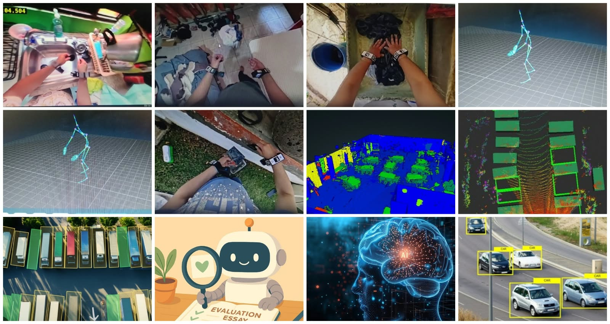

  

---

## 👋 About Me

I'm a native Indonesian (ID-ID) speaker and AI Trainer with hands-on experience in AI data annotation, video annotation, robotics motion capture, and AI response evaluation.

With a background in warehouse operations and inventory management, I bring strong attention to detail, analytical thinking, and quality control skills to AI data projects.

I also have experience working with structured annotation guidelines, evaluating AI-generated outputs, and performing data labeling tasks across different project types.

---

## 💼 Professional Skills

  
  
  
  
  
  
  
  
  

-----

## 📂 Portfolio Projects

**1. LiDAR Point Cloud Annotation – Parking Lot**  
3D object identification, vehicle detection, and point cloud annotation.

**2. 3D Bounding Box Annotation**  
3D object localization, bounding box placement, and spatial labeling.

**3. First-Person Video Annotation**  
Human activity recognition, object interaction, and movement annotation.

**4. Robotics Motion Capture**  
Human motion tracking, movement annotation, and activity description.

**5. Floor Plan Annotation**  
Room identification, object labeling, and spatial layout annotation.

## 💼 Experience & Skills

- **AI Annotation:** Image, video, 3D bounding box, and LiDAR annotation
- **AI Evaluation:** AI response evaluation and data quality assessment
- **Robotics:** Motion capture and human movement annotation
- **Language Tasks:** Indonesian transcription and language evaluation
- **Data Management:** Data processing, reporting, and Microsoft Excel (Intermediate)

## 💼 Project Experience

- **AI Data Annotation & Evaluation:** Image annotation, image description, prompt response, and AI response/image evaluation based on project guidelines.
- **Robotics Motion Capture:** Human movement annotation and action description.
- **Parking Lot & Floor Plan Annotation:** Vehicle detection, spatial labeling, and floor plan annotation.
- **First-Person Video Annotation:** Human activity, object interaction, and movement annotation.
- **Email Data Collection:** Email data collection, organization, and EML file conversion.

## 🌍 Languages

- Indonesian: Native
- English: Professional reading and writing

---

## 📬 Contact & Connect

  
  

## Portfolio Preview

---

*Interested in contributing to AI training, data annotation, and machine learning projects.*
